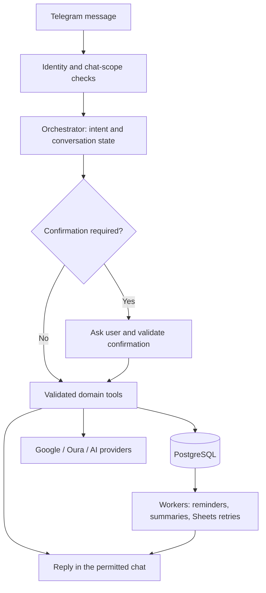
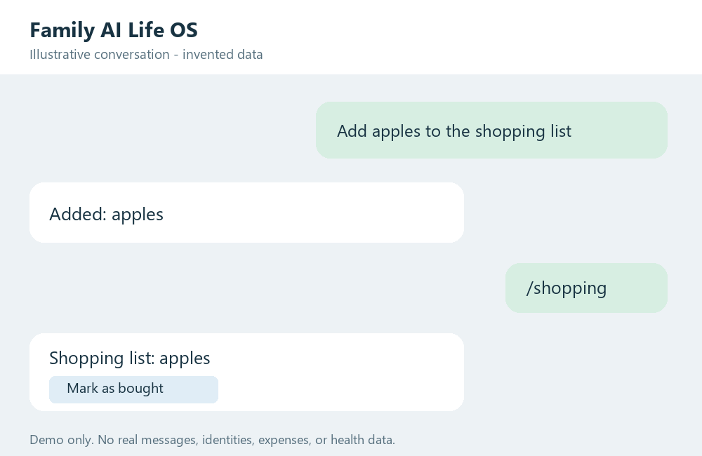

# Family AI Life OS

A Telegram assistant for a small, allowlisted household: shared tasks, expenses,
reminders, Google Workspace, and private Oura health summaries.

This is a working prototype, not a public sign-up service. The repository is
public; household records and deployment credentials belong outside Git.

## Release status

The consolidated candidate is under review in [draft PR #30](https://github.com/GarnikSacsha/FAMILY-AI-LIFE-OS/pull/30).
It has **not been deployed** to the working bot. GitHub CI passed for candidate
`57d6a33` on 2026-11-10; later edits require their own checks.

See [validation and limitations](docs/operations/RELEASE_VALIDATION.md),
[consolidated changes](docs/operations/CONSOLIDATION.md), and
[release procedure](docs/operations/RELEASE.md). Older feature matrices describe
historical snapshots, not live production status.

## Capabilities

| Area | Implemented behavior |
| --- | --- |
| Planning | Tasks and shopping lists; completion, renaming, due dates, reminders, and calendar follow-ups |
| Finance | Expense parsing, categories, confirmation, deduplication, PostgreSQL persistence, and Google Sheets projection |
| Google | OAuth connection and recovery; Gmail and Calendar tools in private chats |
| Health | Private Oura daily, weekly, and monthly reports; encrypted saved provider history; explanations with fallback |
| Input | Text, OpenAI voice transcription, and Gemini food-image analysis |
| Shared context | PostgreSQL-backed recent conversation context, structured facts, daily summaries, and retry delivery |

Provider-backed features require credentials and permissions. PostgreSQL is the
primary financial store; Google Sheets is a projection. Vector retrieval/RAG,
a complete S3 document pipeline, bank-statement ingestion, and independent
domain-agent services are not finished features.

## Architecture and Telegram flow



The application is a Python modular monolith. FastAPI serves HTTP and OAuth
callbacks, aiogram handles Telegram polling, SQLAlchemy/Alembic manage data,
and workers handle scheduled or retried work. Redis is part of the deployment
stack. Domain responsibilities live in tools and orchestration code; `AGENTS.md`
also describes target architecture.

### Example interaction



This is a synthetic illustration, **not a screenshot of a real conversation**.
It contains no account identifiers, transactions, or health measurements.
Actual Telegram rendering and wording can differ.

Commands include `/tasks`, `/shopping`, `/google`, `/google reconnect`, `/health`,
`/weekly_health`, and `/monthly_health`. Health and account connection commands
belong in private chats. Tasks support inline controls; editing prompts use
Telegram Reply. Expenses may require confirmation before being saved.

## Privacy and data processing

- Access is limited to two configured Telegram identities and an optional family
  group. User-owned and household-owned records have different scopes.
- OAuth tokens and Oura provider snapshots use authenticated encryption.
  Preserve the configured encryption key during upgrades and recovery.
- Voice, food images, and other AI-assisted workflows send relevant input to
  their configured provider. **Health explanations send allowlisted numerical
  Oura aggregates and coverage information to the configured OpenAI provider.**
  This path excludes user identifiers, raw provider payloads, and free-text
  records; the measurements are still sensitive health information. Missing
  credentials or provider failures use a deterministic explanation fallback.
- Health summaries are descriptive wellness information, not medical diagnoses.
- Do not publish real chats, exported tables, logs, database copies, OAuth
  payloads, or credentials. A passing secret scan does not prove the absence of
  personal data. Ignoring a path does not untrack committed files; deleting a
  file does not erase Git history.

See [SECURITY.md](SECURITY.md) for additional controls and limitations.

## Run a separate development instance

Prerequisites: Git and Docker with Compose v2. The checked Docker runtime uses
Python 3.12. Use a **separate development Telegram bot**, accounts, databases,
and integration resources. A second polling process using the production token
can disrupt the working bot.

1. Copy the template locally in PowerShell:

   ```powershell
   Copy-Item .env.example .env
   ```

2. Fill configuration privately. Important values include `POSTGRES_PASSWORD`,
   `REDIS_PASSWORD`, `TELEGRAM_BOT_TOKEN`, `SECRET_KEY`, `TOKEN_ENCRYPTION_KEY`,
   `DENYS_TELEGRAM_ID`, and `OLEKSANDRA_TELEGRAM_ID`. The two historically named
   ID settings select the two allowed users. Configure `FAMILY_GROUP_CHAT_ID`
   only for the intended development group. The encryption key must encode
   32 random bytes in Base64. Add provider credentials and callback URLs for
   enabled integrations; see [settings](app/config/settings.py). Never commit `.env`.

3. Build and start the isolated stack:

   ```powershell
   docker compose up -d --build
   docker compose ps
   ```

   Compose runs `migrate` before `app` to prepare the schema and identities.
   Do not downgrade a live database. The checked Compose file does not publish
   an HTTP port; OAuth needs separately configured, reachable callback URLs
   matching the provider registration.

4. Stop development services while preserving their volumes:

   ```powershell
   docker compose stop
   ```

`/live` checks HTTP liveness; `/health` checks readiness. Neither proves that
Telegram and all external integrations work end to end.

## Tests and quality

Use Python 3.12 and a separate virtual environment:

```powershell
py -3.12 -m venv .venv
.\.venv\Scripts\python.exe -m pip install ".[dev]"
.\.venv\Scripts\python.exe -B scripts/run_offline_tests.py -q
.\.venv\Scripts\python.exe -m ruff check .
.\.venv\Scripts\python.exe -m ruff format --check .
.\.venv\Scripts\python.exe -m mypy app
```

The offline runner disables dotenv loading and outbound socket connections;
it does not validate live providers or replace PostgreSQL migration checks.
[CI](.github/workflows/ci.yml) runs formatting, lint, types, PostgreSQL migrations,
pytest with an 80% coverage threshold, Bandit, dependency auditing, Docker/Trivy,
and Gitleaks.

Recorded candidate validation: **558 tests passed, one skipped**; the separate
PostgreSQL migration module passed all three tests. Branch-inclusive coverage
was **82.69%**. See the validation report for versions and scoped scanner
exceptions. Dependency ranges are not a lockfile: rebuilds need fresh checks.

## Repository guide

- `app/telegram/`, `app/orchestration/`, `app/tools/`: interaction and domain behavior.
- `app/integrations/`: Google, Oura, Gemini, OpenAI, and LLM adapters.
- `app/domains/`, `alembic/`: models and schema migrations.
- `tests/`: regression and integration tests.
- `docs/operations/`: provenance, validation, Sheets operations, and releases.
- [CONTEXT.md](CONTEXT.md), [REQ.md](REQ.md), [STATE.md](STATE.md),
  [STATUS.md](STATUS.md): product vision and historical implementation records.

Production uses a single Telegram polling instance. Railway is connected to
`main`; changing it can trigger deployment. Review, merge, and rollout are
distinct decisions. Preserve the existing deployment for rollback and validate
provider behavior after an authorized release.

## License

[MIT](LICENSE).
